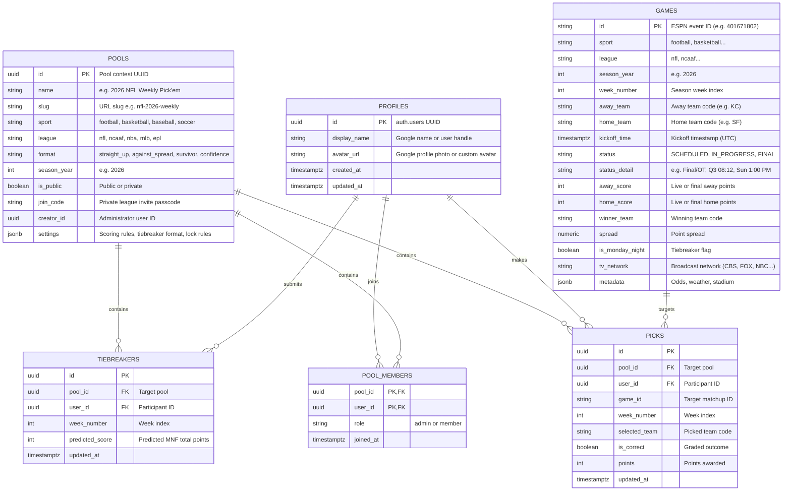

# 🏈 Sports Weekly Pool & Prediction Platform

A high-performance, full-stack sports prediction platform built with **Next.js 16 (App Router)**, **React 19**, **Tailwind CSS**, and **Supabase (PostgreSQL with Row Level Security & OAuth)**.

Engineered with a **modular, multi-sport architecture** that powers the **2026 NFL Weekly Pick'em** today while providing native foundations for **College Football (NCAAF)**, **NBA**, **Premier League (EPL)**, **Survivor pools**, and **private friend/office leagues**.

---

## 📐 System Architecture & Entity Relationships

The platform decouples game schedules, contest formats, user profiles, and participant picks into an extensible entity model:



---

## 📦 Domain Models & TypeScript Interfaces

Located in [`src/types/index.ts`](file:///c:/Users/hbpri/weekly-pool/src/types/index.ts).

### 1. Extensibility & Tournament Types

| Type / Interface | Purpose | Description |
| :--- | :--- | :--- |
| `SportType` | Enum | `"football" \| "basketball" \| "baseball" \| "soccer" \| "hockey"` |
| `LeagueType` | Enum | `"nfl" \| "ncaaf" \| "nba" \| "mlb" \| "epl"` |
| `PoolFormat` | Enum | `"straight_up" \| "against_spread" \| "survivor" \| "confidence"` |
| `Pool` | Interface | Represents a contest with scoring format, public/private visibility, league parameters, and JSON configuration. |
| `PoolMember` | Interface | Associates users with contests and designates administrative or participant roles. |

### 2. Matchup & Live Game Models

| Interface | Purpose | Description |
| :--- | :--- | :--- |
| `Game` | Interface | Canonical event representation normalized across live ESPN APIs and database persistence. Contains teams, scores, network, kickoff timestamps, and status flags. |
| `NFLTeam` | Interface | Team branding record containing city, nickname, colors, logos, and division/conference data. |
| `Week` | Interface | Full slate container representing a single week, including its lock date and scheduled matchups. |

### 3. Picks, Scores & Leaderboard Models

| Interface | Purpose | Description |
| :--- | :--- | :--- |
| `Pick` | Interface | An individual participant's selection on a game, tracking grading outcome and point rewards. |
| `LeaderboardEntry` | Interface | Computed standings record calculating season rank, weekly points, accuracy percentage, tiebreaker score differential, and the complete "Who Picked Who" matchup matrix. |
| `UserProfile` | Interface | Participant identity model holding display name, Google avatar, and cumulative points. |

---

## 🗄️ Database Schema & Security Architecture

The database schema is defined in [`supabase/schema_v2.sql`](file:///c:/Users/hbpri/weekly-pool/supabase/schema_v2.sql).

### Table Specifications

1. **`public.profiles`**: Synchronizes user details (`display_name`, `avatar_url`) from `auth.users`. Populated automatically when users sign in via Google OAuth or Email.
2. **`public.pools`**: Stores tournament pools. Pre-seeds default public pool (`00000000-0000-0000-0000-000000000001` - `"2026 NFL Weekly Pick'em"`).
3. **`public.pool_members`**: Maps users to pools they participate in.
4. **`public.games`**: Stores schedule and live scores. Uses event ID primary keys (compatible with ESPN event IDs) with compound indexes on `(league, season_year, week_number)` and `kickoff_time`.
5. **`public.picks`**: Stores weekly selections with a unique compound constraint: `UNIQUE (pool_id, user_id, game_id)`.
6. **`public.tiebreakers`**: Stores total score predictions for Monday Night Football with `UNIQUE (pool_id, user_id, week_number)`.

### Row Level Security (RLS) Design

The V2 schema uses a **clean, deadlock-free security model**:
- **Public Visibility**: Matchups, pools, pool members, and picks are viewable by all participants (`SELECT USING (true)`), which enables real-time transparency for the leaderboard and "Who Picked Who" scoreboard.
- **Strict Self-Management**: Write operations (`INSERT`, `UPDATE`, `DELETE`) are strictly constrained to the authenticated user (`WITH CHECK (auth.uid() = user_id)`).
- **Application-Layer Lock Enforcement**: Kickoff lockouts and submission deadlines are enforced at the application level rather than via restrictive database subqueries. This prevents cryptic Postgres 42501 transaction failures when ingesting live third-party game feeds.

### Automatic User Onboarding Trigger

A PostgreSQL `SECURITY DEFINER` trigger automatically runs whenever a new record is added to `auth.users`:
```sql
CREATE TRIGGER on_auth_user_created
  AFTER INSERT ON auth.users
  FOR EACH ROW EXECUTE PROCEDURE public.handle_new_user();
```
This trigger automatically:
1. Provisions the user's profile with their Google avatar and name.
2. Automatically enrolls the user into the featured default NFL pool.

---

## 🛠️ Core Services & Function Reference

### 1. Sports Data Engine ([`src/lib/api/nfl.ts`](file:///c:/Users/hbpri/weekly-pool/src/lib/api/nfl.ts))

- **`fetchNFLWeekSchedule(targetWeek, seasonYear, forceFresh)`**: Queries ESPN's live Scoreboard API endpoint for the requested week. Normalizes teams, live clock, network broadcasts, scores, and status into canonical `Game` objects. Implements a 60-second in-memory cache to prevent rate-limiting.
- **`fetchCurrentActiveNFLWeek()`**: Queries ESPN to determine the active NFL calendar week dynamically, rolling over after Monday Night Football.
- **`syncScheduleToSupabase(games, weekNumber, seasonYear)`**: Synchronizes live matchups and game scores into the Supabase `public.games` table.
- **`calculateFallbackWeek(date)`**: Calendar fallback algorithm that calculates the active NFL week index based on the season calendar if the remote network is unavailable.

### 2. Pool & Picks Engine ([`src/lib/supabase/picks-service.ts`](file:///c:/Users/hbpri/weekly-pool/src/lib/supabase/picks-service.ts))

- **`saveUserPicksToSupabase(userId, picks, mnfScore, weekNumber, games, poolId)`**: Saves or updates a user's weekly selections and tiebreaker predictions. Automatically checks and syncs game records, handles user profile upserts, and supports both V2 and V1 schemas with automatic fallback.
- **`fetchUserPicksFromSupabase(userId, weekNumber)`**: Retrieves a participant's saved selections and tiebreaker prediction for a specified week.
- **`fetchLiveLeaderboard(weekNumber, liveGames)`**: Aggregates all participant picks across all weeks, compares them against game outcomes, applies tiebreaker differentials, and computes cumulative season points, weekly ranks, and win percentages.
- **`fetchWeekGames(weekNumber, seasonYear, forceFresh)`**: Orchestrates game fetching with a multi-tier fallback: live ESPN API $\rightarrow$ Supabase database cache $\rightarrow$ mock fallback data.
- **`getCurrentUser()`**: Fetches the authenticated Supabase user session and metadata.

### 3. Authentication & OAuth Pipeline

- **OAuth Callback Handler** ([`src/app/auth/callback/route.ts`](file:///c:/Users/hbpri/weekly-pool/src/app/auth/callback/route.ts)): Next.js App Router server handler that exchanges Google OAuth authorization codes for authenticated Supabase session cookies via `@supabase/ssr`.
- **Auth Modal** ([`src/components/AuthModal.tsx`](file:///c:/Users/hbpri/weekly-pool/src/components/AuthModal.tsx)): Branded modal supporting 1-click **Continue with Google** authentication and email/password fallback. Displays user avatars, Supabase user IDs, and actionable setup guides.

---

## 📱 User Interface Architecture

The application is structured into four primary navigation views ([`Navbar.tsx`](file:///c:/Users/hbpri/weekly-pool/src/components/Navbar.tsx)):

1. **Make Picks Tab** ([`page.tsx`](file:///c:/Users/hbpri/weekly-pool/src/app/page.tsx), [`GameCard.tsx`](file:///c:/Users/hbpri/weekly-pool/src/components/GameCard.tsx)):
   - Interactive game cards displaying team helmets/logos, records, kickoff timestamps, network channels, and spreads.
   - Monday Night Football stepper for total points prediction.
   - Offline-resilient local cache (`localStorage`) ensuring picks are never lost if a user is disconnected.
2. **Weekly Scoreboard Tab** ([`WeeklyScoreboard.tsx`](file:///c:/Users/hbpri/weekly-pool/src/components/WeeklyScoreboard.tsx)):
   - **"Who Picked Who" Matrix**: A grid mapping participants across all matchups of the week, with real-time indicators for winning, losing, and pending selections.
   - **Matchup Scorecards**: Live cards with quarter clocks, live scores, and network badges.
   - **Weekly Standings**: Focused view of the current week's contest.
3. **Season Leaderboard Tab** ([`LeaderboardTable.tsx`](file:///c:/Users/hbpri/weekly-pool/src/components/LeaderboardTable.tsx)):
   - Gold/Silver/Bronze podium cards displaying user avatars and win rates.
   - Sortable standings table tracking total points, correct picks, and accuracy percentage.
4. **Rules & Guidelines Tab** ([`RulesCard.tsx`](file:///c:/Users/hbpri/weekly-pool/src/components/RulesCard.tsx)):
   - Official contest guidelines detailing straight-up scoring, kickoff lock times, tiebreaker calculation, and prize policies.

---

## 🚀 Future Expansion Roadmap

The V2 schema is built for forward expansion without breaking schema migrations:

### 1. Multi-Sport & Multi-League Expansion
- **College Football (NCAAF)**: Set `sport: 'football'` and `league: 'ncaaf'`. Sync top-25 or Saturday schedules from ESPN's college football endpoint.
- **NBA Basketball**: Set `sport: 'basketball'` and `league: 'nba'` for playoff or weekly pick'em contests.
- **European Soccer (EPL)**: Set `sport: 'soccer'` and `league: 'epl'` for weekend matchday pick'ems.

### 2. Additional Contest Formats
- **Against the Spread (ATS)**: Uses the existing `spread` column in `public.games` to grade picks against the line.
- **Survivor / Knockout Pool**: Uses `public.picks` with a single pick per week, enforcing that a participant cannot select the same team twice.
- **Confidence Pool**: Assign point weights (e.g. 1-16) to each pick stored in `picks.points`.

### 3. Private Office & Friend Pools
- Private leagues generate a 6-character `join_code` in `public.pools`.
- Participants join via a shareable link or code, creating an entry in `public.pool_members`.
- The UI filters the leaderboard and scoreboard to the active pool context.

---

## ⚡ Setup & Deployment

### 1. Environment Configuration

Create a `.env.local` file with your credentials:

```env
# Supabase Configuration
NEXT_PUBLIC_SUPABASE_URL=https://your-project.supabase.co
NEXT_PUBLIC_SUPABASE_ANON_KEY=your-anon-key
NEXT_PUBLIC_SUPABASE_PUBLISHABLE_KEY=your-anon-key

# Application Settings
NEXT_PUBLIC_APP_NAME="NFL Weekly Pool"
NEXT_PUBLIC_SEASON_YEAR=2026
```

### 2. Database Initialization

Execute the complete reset and provisioning script in your Supabase SQL Editor:
- Script path: [`supabase/schema_v2.sql`](file:///c:/Users/hbpri/weekly-pool/supabase/schema_v2.sql)

### 3. Development Server

```bash
npm install
npm run dev
```

Visit [http://localhost:3000](http://localhost:3000) to view the pool.

### 4. Production Deployment

The project is optimized for [Vercel](https://vercel.com):
```bash
git push origin main
```
Vercel automatically builds and deploys changes on push to `main`.
