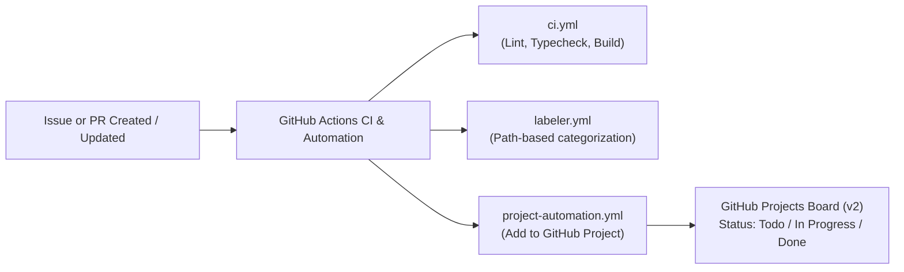

# 🛠️ GitHub Projects (v2) & Actions Integration Guide

This guide walks you through connecting your existing **GitHub Projects (v2)** board with the `hbprice65/weekly-pool` repository and using GitHub Actions to automate your workflow.

---

## 1. Quick Architecture Overview

---

## 2. Linking Your Existing GitHub Project to this Repository

GitHub Projects v2 supports two complementary ways to link:

### Option A: Native GitHub Projects Link (Recommended Baseline)
1. Open your existing GitHub Project board (e.g. `https://github.com/users/hbprice65/projects/<number>`).
2. Click the **`...`** (menu) in the top-right corner of the Project board -> **Settings**.
3. Under **Manage access**, select **Linked repositories**.
4. Click **Link a repository** and select `hbprice65/weekly-pool`.
5. Under the Project **Workflows** tab (in project settings or left navigation):
   - **Auto-add to project**: Turn **On** for `hbprice65/weekly-pool` (all issues and pull requests will appear on your board automatically).
   - **Item closed**: Set to update status to **`Done`** when an issue or PR is closed/merged.
   - **Pull request merged**: Set to update status to **`Done`**.

---

### Option B: GitHub Actions Automation (`project-automation.yml`)

The repository includes [`.github/workflows/project-automation.yml`](file:///.github/workflows/project-automation.yml) which uses the official `actions/add-to-project@v1` action. This allows cross-account project routing and conditional board assignment.

To activate the action:

#### Step 1: Create a Personal Access Token (PAT)
1. Go to **GitHub Settings** -> [Personal Access Tokens (Classic or Fine-grained)](https://github.com/settings/tokens).
2. If using **Classic**:
   - Check the **`project`** scope (Full control of user and organization projects).
   - (If private repo) Check **`repo`** scope.
3. If using **Fine-grained**:
   - Repository access: All repositories or `hbprice65/weekly-pool`.
   - Account permissions -> **Projects**: Read and Write.
4. Copy the generated token string.

#### Step 2: Add Repository Secrets & Variables
1. In your `weekly-pool` repository, go to **Settings** -> **Secrets and variables** -> **Actions**.
2. **Repository Secret**:
   - Name: `PROJECTS_TOKEN`
   - Value: `<your-copied-personal-access-token>`
3. **Repository Variable**:
   - Go to the **Variables** tab -> **New repository variable**.
   - Name: `PROJECT_URL`
   - Value: `https://github.com/users/hbprice65/projects/<your-project-number>` (or `https://github.com/orgs/<org>/projects/<number>`).

> [!NOTE]
> If `PROJECTS_TOKEN` is not yet set, the action logs a helpful notice and exits cleanly without failing your repository status checks.

---

## 3. Recommended GitHub Project Board Configuration

To get the most out of your Weekly Pool project board, configure the following custom fields and views:

### Recommended Custom Fields
| Field Name | Type | Options | Purpose |
| :--- | :--- | :--- | :--- |
| **Status** | Single Select | `Backlog`, `Todo`, `In Progress`, `In Review`, `Done` | Core Kanban column routing |
| **Priority** | Single Select | `P0 - Urgent`, `P1 - High`, `P2 - Normal`, `P3 - Low` | Triage priority |
| **Category** | Single Select | `Frontend`, `Backend & DB`, `ESPN API`, `Tiebreakers`, `Admin Tools` | Aligns with PR labeler |
| **NFL Week** | Single Select | `Week 1`, `Week 2` ... `Week 18`, `Playoffs`, `Super Bowl` | Weekly sprint/milestone tracking |

### Recommended Views
1. **📋 Main Kanban Board**:
   - Layout: **Board**
   - Column field: `Status`
   - Sort: `Priority` (Descending)
2. **🏈 NFL Weekly Slate Roadmap**:
   - Layout: **Table**
   - Group by: `NFL Week`
   - Filter: `Status != Done`
3. **🐛 Bug Triage**:
   - Layout: **Table**
   - Filter: `label:bug`

---

## 4. How the Integrated Suite Works Together

| Component | File | How It Integrates |
| :--- | :--- | :--- |
| **Enhanced CI** | [`.github/workflows/ci.yml`](file:///.github/workflows/ci.yml) | Runs ESLint, `tsc --noEmit`, and Next.js production build with Turbopack and build caching. Auto-cancels outdated runs. |
| **Project Automation** | [`.github/workflows/project-automation.yml`](file:///.github/workflows/project-automation.yml) | Automatically adds new issues and PRs into your GitHub Project board. |
| **PR Labeler** | [`.github/workflows/labeler.yml`](file:///.github/workflows/labeler.yml) & [`.github/labeler.yml`](file:///.github/labeler.yml) | Automatically labels PRs with `frontend`, `backend`, `database`, `ci/cd`, or `documentation` based on changed files. |
| **Dependabot** | [`.github/dependabot.yml`](file:///.github/dependabot.yml) | Automatically checks for weekly npm & GitHub Actions updates, grouping minor/patch updates to minimize noise. |
| **Issue Templates** | [`.github/ISSUE_TEMPLATE/`](file:///.github/ISSUE_TEMPLATE/) | Structured GitHub forms for Bug Reports, Feature Requests, and NFL Week Operations. |
| **PR Template** | [`.github/pull_request_template.md`](file:///.github/pull_request_template.md) | Enforces linked issue keywords (e.g. `Fixes #123`), which auto-closes issues and moves Project cards to **Done** on merge. |

---

## 5. Daily Development Workflow

1. **Pick or create an item in GitHub Projects**:
   - Create an issue using the Bug Report, Feature Request, or NFL Week Ops template.
   - The card appears in **Todo** / **Backlog**.
2. **Create a feature branch & open a PR**:
   - Make your code changes.
   - In the PR description, include `Fixes #<issue-number>`.
   - The PR Auto-Labeler will label the PR (e.g., `frontend`, `database`).
   - The Project board moves the item to **In Progress**.
3. **Automated CI runs**:
   - Linting, TypeScript typecheck, and Next.js build run automatically.
4. **Merge PR**:
   - Once merged to `main`, GitHub automatically closes the linked issue and advances the project card to **Done**.
